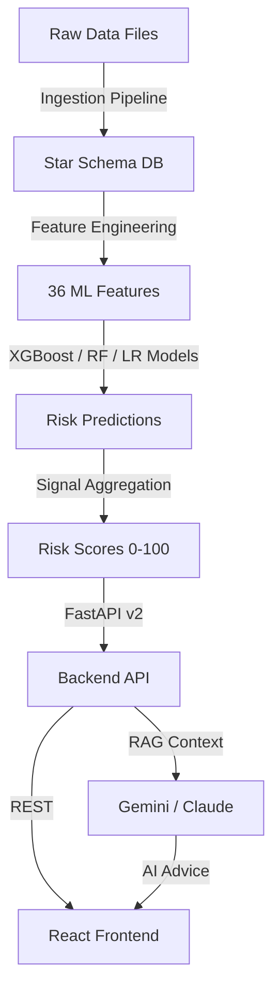

# AI-Based Early Warning System (EWS) for Student Retention

[]()
[]()
[]()
[]()

## Table of Contents

1. [Overview](#overview)
2. [System Architecture](#system-architecture)
3. [Features & Capabilities](#features--capabilities)
4. [Technology Stack](#technology-stack)
5. [Data Flow & Processing](#data-flow--processing)
6. [Setup & Installation](#setup--installation)
7. [Configuration](#configuration)
8. [API Documentation](#api-documentation)
9. [Frontend Architecture](#frontend-architecture)
10. [ML Pipeline](#ml-pipeline)
11. [Risk Scoring Logic](#risk-scoring-logic)
12. [Advanced Features](#advanced-features)
13. [Deployment](#deployment)
14. [Testing](#testing)
15. [Monitoring & Logging](#monitoring--logging)
16. [Troubleshooting](#troubleshooting)
17. [Contributing](#contributing)

---

## Overview

The EWS Retention Platform is an **AI-driven Early Warning System** (v2.0.0) designed for EdTech companies and educational institutions to proactively identify at-risk learners and optimize student retention, revenue, and learning outcomes.

### Purpose

- **Predict** dropout risk using ML models trained on historical student data
- **Monitor** student engagement across multiple touchpoints (LMS, attendance, assessments)
- **Recommend** personalized, AI-powered interventions via Google Gemini or Anthropic Claude
- **Decide** automated intervention triggers based on configurable risk thresholds
- **Track** effectiveness of interventions over time

### Target Users

- **Faculty**: Real-time alerts, student dashboards, intervention tracking
- **Sales Teams**: Revenue-at-risk metrics, lead prioritization
- **Marketing**: Campaign effectiveness, engagement analytics
- **Leadership**: Executive dashboards, retention KPIs

---

## System Architecture

### High-Level Data Flow



### Component Architecture

```
┌─────────────────────────────────────────────────────────────┐
│                    DATA INGESTION LAYER                     │
│  - File Validators - Row Validators - Quarantine System    │
└────────────────────┬────────────────────────────────────────┘
                     │
                     v
┌─────────────────────────────────────────────────────────────┐
│                  DATABASE LAYER (SQLite)                    │
│           Star Schema: Dimensions + Fact Tables             │
│  DimStudent | DimCourse  | FactEngagement | FactAcademic   │
└────────────────────┬────────────────────────────────────────┘
                     │
                     ├─────────────────────────────────────┐
                     v                                     v
┌──────────────────────────────────┐    ┌─────────────────────────────┐
│  FEATURE ENGINEERING LAYER       │    │   ANALYTICS & REPORTING     │
│  - 36 ML Features (7yr avg +     │    │  - Business Intelligence    │
│    3yr trends)                   │    │  - Cohort Analysis          │
│  - Signal Computation (5 groups) │    │  - Risk Distribution        │
└─────────────┬────────────────────┘    └─────────────────────────────┘
              │
              v
┌─────────────────────────────────────────────────────────────┐
│                    ML PREDICTION LAYER                       │
│  - XGBoost (primary) - RandomForest - LogisticRegression   │
│  - SMOTE Balancing - Feature Validation                     │
└────────────────────┬────────────────────────────────────────┘
                     │
                     v
┌─────────────────────────────────────────────────────────────┐
│                    RISK SCORING LAYER                        │
│  - Signal Aggregation - Weight Application - Bounds Check  │
│  Risk Score Range: 0-100 (percentage)                      │
└────────────────────┬────────────────────────────────────────┘
                     │
                     v
┌─────────────────────────────────────────────────────────────┐
│                    DECISION ENGINE                           │
│  - Threshold Evaluation - Intervention Triggers              │
│  - Priority Assignment - Team Routing                       │
└────────────────────┬────────────────────────────────────────┘
                     │
                     v
┌─────────────────────────────────────────────────────────────┐
│              FASTAPI BACKEND v2 (40+ Endpoints)              │
│  /students | /business | /decisions | /recommendations     │
│  /auth | /advisor | /llm | /features | /analytics          │
└────────────────────┬────────────────────────────────────────┘
                     │
                     ├──────────────────┐
                     v                  v
┌──────────────────────────┐    ┌─────────────────────────────┐
│   REACT FRONTEND         │    │   LLM LAYER                 │
│  - 14 Pages              │    │  - Google Gemini (default)  │
│  - 54+ Components        │    │  - Anthropic Claude (alt.)  │
│  - Real-time Dashboards  │    │  - RAG-Grounded Advice      │
└──────────────────────────┘    └─────────────────────────────┘
```

---

## Features & Capabilities

### 1. Behavioral Monitoring

**Data Sources** (5 categories):
- **Learning Management System**: Logins, assignments, content views, quiz scores
- **Live Classes**: Attendance, duration, participation
- **Website/App Usage**: Video completion, page clicks, time spent
- **Communication**: WhatsApp/Email engagement, response times
- **Marketing Campaigns**: Meta ads, lead sources, conversion tracking

**Frequency**: Real-time to daily updates

### 2. ML Dropout Prediction

**Model Architecture**:
- **Algorithm**: XGBoost Classifier (with RandomForest ensemble fallback)
- **Features**: 36 engineered features
  - 7-year averages: `absrate_avg_1_7`, `mpa_avg_1_7`
  - 3-year trends: `absrate_trend_5_7`, `mobility_trend_5_7`
- **Class Balancing**: SMOTE for handling imbalanced datasets
- **Output**: Dropout probability → Risk score (0-100 percentage)

**Feature Groups** (5 signal categories):
1. **Academic Signals** (30% weight): GPA trends, exam scores, assignment completion
2. **Engagement Signals** (25% weight): Attendance, login frequency, content completion
3. **Consistency Signals** (20% weight): Behavioral stability, activity volatility
4. **Intent Signals** (15% weight): Goal-setting behavior, course progression
5. **Responsiveness Signals** (10% weight): Communication response time, ticket resolution

### 3. Automated Intervention Triggers

**Risk Thresholds** (configurable via `backend/config.py`):

| Risk Probability | Category | Action | Assigned Team | Urgency |
|------------------|----------|--------|---------------|---------|
| < 30%            | Low      | No action | Self-service | None |
| 30–60%           | Medium   | Gentle reminder | Automated email | Low |
| 60–80%           | High     | Mentor outreach | Academic mentor | Medium |
| >= 80%           | Critical | Urgent intervention | Sales + WhatsApp | High |

**Intervention Cooldown**: 7 days minimum between interventions per student
**Risk Spike Override**: Cooldown bypassed if risk increases by > 15 percentage points

**Intervention Channels**:
- Email (automated templates)
- WhatsApp messages
- In-app notifications
- Faculty dashboard alerts
- Phone calls (for critical cases)

### 4. AI-Powered Recommendations

**Dual LLM Support** (switchable via `LLM_PROVIDER` env var):
- **Google Gemini** (`gemini-pro`, default): RAG-grounded recommendations
- **Anthropic Claude** (`claude-3-opus-20240229`, alternative): Drop-in replacement

**Recommendation Types**:
- Personalized study plans
- Resource suggestions (videos, practice tests)
- Communication templates for faculty
- Peer mentoring matches

**Context Window**: 7-day activity history + risk trends + intervention history

### 5. Business Intelligence

**Revenue Impact Metrics**:
- Revenue at Risk: `high_risk_count × AVG_STUDENT_LTV` (default LTV: $12,500)
- Retention ROI: Cost of intervention ($350/student) vs. recovered revenue
- Cohort Performance: Comparative analysis by program/batch

**Executive Dashboards**:
- Real-time retention KPIs
- Intervention effectiveness tracking
- Resource allocation optimization

---

## Technology Stack

### Backend

| Component | Technology | Version | Purpose |
|-----------|-----------|---------|---------|
| Framework | FastAPI | 0.104+ | High-performance async API |
| ORM | SQLAlchemy | 2.0+ | Database abstraction |
| Database | SQLite | 3.40+ | Data persistence (star schema) |
| ML Framework | XGBoost | 2.0+ | Primary dropout prediction model |
| ML Baseline | scikit-learn (LR, RF) | 1.3+ | RandomForest fallback + Logistic Regression baseline |
| Class Balancing | imbalanced-learn | 0.11+ | SMOTE oversampling (imblearn pipelines) |
| Data Processing | pandas | 2.1+ | Data manipulation |
| Validation | Pydantic | 2.0+ | API schema validation |
| LLM (Primary) | google-generativeai | latest | Gemini API client |
| LLM (Alternative) | anthropic | latest | Claude API client |
| Authentication | python-jose + passlib | latest | JWT auth (HS256, 24h TTL) |
| Caching | redis | latest | Response caching (1h TTL) |
| PDF Reports | fpdf | latest | Report generation |
| Model Serialization | joblib | latest | ML model persistence |
| Scheduling | schedule | latest | Automated prediction updates |
| File Upload | python-multipart | latest | Multipart form data handling |
| Environment | python-dotenv | latest | .env file management |
| Numerical | numpy | latest | Numerical computations |

### Frontend

| Component | Technology | Version | Purpose |
|-----------|-----------|---------|---------|
| Framework | React | 18.2+ | UI component library |
| Routing | React Router | 6.20+ | SPA navigation |
| State Management | Context API | Built-in | Global state |
| Charts | Chart.js + Recharts | Latest | Data visualization |
| UI Components | Bootstrap | 5.3+ | Responsive design |
| Animations | Framer Motion | 10.0+ | UI micro-interactions |
| Icons | React Icons | 4.12+ | Icon library |

### DevOps

| Component | Technology | Purpose |
|-----------|-----------|---------|
| Containerization | Docker | Backend + frontend containerization |
| Orchestration | Docker Compose | Multi-container deployment |
| Reverse Proxy | Nginx | (Optional) Load balancing |
| CI/CD | GitHub Actions | (Optional) Automated testing |

---

## Data Flow & Processing

### 1. Data Ingestion Pipeline

**Source**: Excel/CSV files placed in `data/raw/`

**Key Input Files** (configured in `backend/config.py`, placed in `data/raw/`):

| File | Description |
|------|-------------|
| `Engagement_Analysis.xlsx` | Primary learner usage dump (students, courses, enrollments) |
| `_Trimester-1 2025 Attendance Quiz-Assignment-Exam 5Jan2025 (1).xlsx` | T1 attendance, quiz, assignment, and exam records |
| `B.S and M.Sc Live Summary Data C-1, Trimester 1 (1).xlsx` | Live session attendance — Trimester 1 |
| `B.S and M.Sc Summary Data Trimester 2 (1).xlsx` | Live session attendance — Trimester 2 |
| `Week 1-2 Student Engagement Analysis.xlsx` | Early engagement snapshot (weeks 1–2) |
| `Graded Quiz 1 Status 9 feb.xlsx` | Quiz 1 status snapshot (9 Feb) |
| `graded quiz 1 10 feb complete.xlsx` | Quiz 1 full export (10 Feb, original) |
| `graded quiz 1 10 feb 11_15 AM.xlsx` | Quiz 1 snapshot — 10 Feb 11:15 AM |
| `Graded quiz 1 10 feb 4_51 pm.xlsx` | Quiz 1 snapshot — 10 Feb 4:51 PM (latest, used as canonical) |
| `Learner usage week 3.xlsx` | Platform usage dump — week 3 |
| `Learner usage week 5.xlsx` | Platform usage dump — week 5 |

**Process Flow**:
```
Raw File (.xlsx)
    → File Validator (schema check)
    → Row Validator (data quality checks)
    → [Pass] → Star Schema DB
    → [Fail] → Quarantine (error logging)
```

**Validation Rules** (see `backend/ingestion/row_validators.py`):
- Excel error detection (`#DIV/0!`, `#VALUE!`, `#N/A`, `#REF!`)
- Null/NaN/Inf guards
- Percentage bounds (0-1 or 0-100 normalization)
- Timestamp sanity (no future dates, epoch >1970)
- Email format validation (RFC 5322)
- Negative value checks (for non-negative fields)

**Quarantine System**:
- Invalid rows → `backend/ingestion/quarantine.py`
- Errors logged → `backend/ingestion/error_logger.py`
- Original data preserved for manual review

### 2. Star Schema Database

**Database location**: `backend/data/sql_app.db`

**Canonical models**: `backend/database/models/canonical.py`

**Dimension Tables**:

| Table | Key Columns |
|-------|-------------|
| `dim_students` | `student_id` (email PK), `org_defined_id`, `student_bits_id`, `student_name`, `program` (BS/MSc), `cohort`, `trimester`, `enrollment_status`, `is_new_student` |
| `dim_courses` | `course_id` (PK), `course_code`, `course_name`, `department`, `trimester`, `program`, `faculty_name` |

**Fact Tables**:

| Table | Key Columns |
|-------|-------------|
| `fact_academic_performance` | `student_id`, `course_id`, `assessment_type`, `max_score`, `scored`, `percentage`, `submitted`, `late_submission`, `data_snapshot_date`, `source_file` |
| `fact_engagement` | `student_id`, `metric_date`, `metric_week`, `live_sessions_attended`, `attendance_percentage`, `total_time_minutes`, `login_count`, `days_active`, `content_items_viewed`, `data_snapshot_date` |
| `fact_consistency` | `student_id`, `weeks_with_attendance`, `attendance_streak_current`, `attendance_streak_max`, `attendance_variance`, `weeks_with_login`, `avg_logins_per_week`, `engagement_trend`, `week_over_week_change` |
| `fact_intent_responsiveness` | `student_id`, `hours_before_deadline`, `attempt_count`, `welcome_email_opened`, `response_time_hours`, `no_login_days`, `zero_participation_weeks`, `message_type`, `message_priority` |

All fact tables include a `data_snapshot_date` column for temporal versioning — enabling point-in-time analysis as new data snapshots are loaded.

**Data Lineage**:
- `data_lineage`: ETL audit trail (source file, sheet name, target table, records processed/inserted/updated/skipped/errored, processing duration)

### 3. Feature Engineering

The platform uses two feature engineering approaches depending on the data source:

**Backend Pipeline — 36 Historical Features** (`backend/ml/features/feature_engineering.py`):

Processes 7-year historical CSV records into per-student averages and 3-year trend slopes.

- **Per-year averages**: `mpa_avg_1` … `mpa_avg_7`, `absrate_avg_1` … `absrate_avg_7`, `nsusp_avg_1` … `nsusp_avg_7`, `mobility_avg_1` … `mobility_avg_7`
- **3-year trend slopes** (years 5–7, linear regression): `mpa_avg_trend_3yr`, `absrate_avg_trend_3yr`, `nsusp_avg_trend_3yr`, `mobility_avg_trend_3yr`

```python
# 3-year trend (years 5-7, linear regression slope)
from numpy.linalg import lstsq
x = [5, 6, 7]; y = [absrate5, absrate6, absrate7]
absrate_avg_trend_3yr = lstsq([[xi, 1] for xi in x], y)[0][0]
```

**Standalone Pipeline — 12 DB-Driven Features** (`models/feature_engineering.py`):

Aggregates live `enrollments` and `courses` tables per student (see [ML Pipeline](#ml-pipeline) for full feature list).

```python
# Example derived ratios
content_completion_rate = content_completed / content_required
quiz_completion_rate    = quiz_completed / total_quiz_attempts
avg_time_per_course     = total_time_spent_seconds / courses_enrolled
```

### 4. Signal Computation

**5 Signal Groups** → Aggregated into risk score

**Example: Academic Signal** (see `backend/ml/inference/predictor.py`):
```python
academic_signal_score = weighted_avg([
    quiz_completion_rate,
    exam_attendance_rate,
    assignment_submission_rate,
    gpa_normalized
])
# Output range: 0-1 (probability)
```

**Signal Weights** (from `backend/config.py`):
```python
SIGNAL_WEIGHTS = {
    'academic': 0.30,
    'engagement': 0.25,
    'consistency': 0.20,
    'intent': 0.15,
    'responsiveness': 0.10
}
# Total: 1.0
```

### 5. Risk Scoring Formula

**Final Risk Score** (see `backend/features/risk_scorer.py`):
```python
risk_score = (
    0.30 * academic_signal_score +
    0.25 * engagement_signal_score +
    0.20 * consistency_signal_score +
    0.15 * intent_signal_score +
    0.10 * responsiveness_signal_score
) * 100  # Convert to percentage (0-100)

# Multi-layer validation
risk_score = max(0.0, min(100.0, risk_score))  # Clamp
assert 0 <= risk_score <= 100
```

**Output**:
- `risk_score`: 0-100 percentage (75.3 = 75.3% dropout risk)
- `risk_level`: "Low" (<30%), "Medium" (30-60%), "High" (60-80%), "Critical" (>=80%)
- `confidence`: Model confidence (0-1)

---

## Setup & Installation

### Prerequisites

- **Python**: 3.10 or higher
- **Node.js**: 18.0 or higher
- **npm**: 9.0 or higher
- **Git**: For version control
- **Redis**: Optional (for caching; falls back gracefully if unavailable)

### Option 1: Docker (Recommended)

```bash
# 1. Clone repository
git clone https://github.com/your-org/ews-retention-platform.git
cd ews-retention-platform

# 2. Create environment file
cp .env.example .env
# Edit .env with your API keys

# 3. Build and run
docker-compose up -d

# 4. Access application
# Frontend: http://localhost:3000
# Backend API: http://localhost:8000
# API Docs: http://localhost:8000/docs
```

### Option 2: Script-Assisted Setup

A convenience script handles virtual environment creation and dependency installation:

```bash
# From project root
bash setup.sh

# Then activate the environment
source venv/bin/activate
```

> **Note**: `setup.sh` uses `/home/duffer/tmp` as `TMPDIR` to avoid `/tmp` space issues on constrained systems. Adjust the path in the script if needed for your environment.

### Option 3: Manual Setup

#### Backend Setup

```bash
# 1. Navigate to backend
cd backend

# 2. Create virtual environment
python -m venv venv
source venv/bin/activate  # On Windows: venv\Scripts\activate

# 3. Install dependencies
pip install -r requirements.txt

# 4. Set environment variables (see Configuration section)
cp .env.example .env
# Edit .env with your credentials

# 5. Start backend server
uvicorn backend.main:app --reload --host 0.0.0.0 --port 8000
```

#### Frontend Setup

```bash
# 1. Navigate to frontend (from project root)
cd frontend

# 2. Install dependencies
npm install

# 3. Configure API URL
echo "REACT_APP_API_URL=http://localhost:8000/api/v1" > .env

# 4. Start development server
npm start

# Access at: http://localhost:3000
```

#### Data Ingestion (Initial Setup)

```bash
# 1. Place raw data files in data/raw/
cp your-data-files/*.xlsx data/raw/

# 2. Data is ingested automatically on backend startup
# Or trigger manually:
cd backend
python -m backend.services.core.data_ingestion

# 3. Verify data loaded
sqlite3 backend/data/sql_app.db "SELECT COUNT(*) FROM dim_students;"
```

---

## Configuration

### Environment Variables

Create a `.env` file in the project root:

```bash
# === LLM Provider ===
# Choose: "gemini" (default) or "claude"
LLM_PROVIDER=gemini

# Google Gemini
GEMINI_API_KEY=your-gemini-api-key
GEMINI_MODEL=gemini-pro

# Anthropic Claude (alternative)
CLAUDE_API_KEY=your-claude-api-key
CLAUDE_MODEL=claude-3-opus-20240229

LLM_TEMPERATURE=0.7
LLM_MAX_TOKENS=1024

# === Database ===
DATABASE_URL=sqlite:///./backend/data/sql_app.db

# === Security ===
SECRET_KEY=your-secret-key-change-in-production
ACCESS_TOKEN_EXPIRE_MINUTES=1440  # 24 hours

# === Redis (optional) ===
REDIS_URL=redis://localhost:6379/0
CACHE_EXPIRE_SECONDS=3600

# === ML Model ===
MODEL_TYPE=xgboost
MODEL_VERSION=v1.0

# === Risk Thresholds (probabilities 0-1) ===
THRESHOLD_NO_ACTION=0.30
THRESHOLD_GENTLE=0.60
THRESHOLD_MENTOR=0.80
RISK_THRESHOLD_HIGH=0.7
RISK_THRESHOLD_MEDIUM=0.4

# === Intervention Settings ===
INTERVENTION_COOLDOWN_DAYS=7
RISK_SPIKE_THRESHOLD=0.15

# === Signal Weights ===
WEIGHT_ACADEMIC=0.30
WEIGHT_ENGAGEMENT=0.25
WEIGHT_CONSISTENCY=0.20
WEIGHT_INTENT=0.15
WEIGHT_RESPONSIVENESS=0.10

# === Business Metrics ===
AVERAGE_STUDENT_LTV=12500.0
TUITION_PER_SEMESTER=6250.0
INTERVENTION_COST=350.0
TARGET_RETENTION_RATE=0.95

# === API ===
API_HOST=0.0.0.0
API_PORT=8000
CORS_ORIGINS=http://localhost:3000

# === Integration ===
INTEGRATION_API_KEY=ews-integration-dev-key
AI_ADVISOR_ORIGIN=http://localhost:8001

# === Frontend ===
REACT_APP_API_URL=http://localhost:8000/api/v1

# === Scheduler ===
SCHEDULER_ENABLED=true
PREDICTION_UPDATE_INTERVAL=3600  # seconds

# === Logging ===
LOG_LEVEL=INFO
```

### Configuration Files

1. **`backend/config.py`**: Centralized backend configuration (paths, thresholds, LLM, scheduler)
2. **`backend/core/logger.py`**: Centralized structured logger (`sys_logger`) used across all backend modules
3. **`backend/core/security.py`**: Security manager (JWT helpers, password hashing via `passlib`)
4. **`frontend/src/config`**: Frontend constants directory
5. **`data/DATA_MANIFEST.md`**: Data file catalog and validation rules

---

## API Documentation

### Base URL

```
http://localhost:8000/api/v1
```

### Authentication

JWT-based authentication is implemented using `python-jose` and `passlib`.

- **Login**: `POST /auth/login` → returns access token
- **Token lifetime**: 24 hours (configurable via `ACCESS_TOKEN_EXPIRE_MINUTES`)
- **Algorithm**: HS256

For production deployments, set a strong `SECRET_KEY` environment variable.

### Rate Limiting

Built-in IP-based rate limiting: **100 requests per minute** per client IP. Exceeding the limit returns `HTTP 429 Too Many Requests`.

### Endpoints

#### Student APIs

##### GET `/students/students`

Retrieve paginated list of students with risk scores.

**Query Parameters**:
- `skip` (int, default=0): Offset for pagination
- `limit` (int, default=50, max=2000): Page size
- `sort_by` (str, default="risk_score"): Sort field
- `order` (str, default="desc"): Sort order (asc, desc)
- `risk_min` / `risk_max` (float, optional): Risk score filter (0-100)

**Response** (200 OK):
```json
{
  "students": [
    {
      "id": "student@example.com",
      "first_name": "John",
      "last_name": "Doe",
      "department": "Engineering",
      "risk_score": 75.3,
      "risk_level": "high",
      "engagement_score": 24.7,
      "signal_breakdown": {
        "academic_signal_score": 0.68,
        "engagement_signal_score": 0.45,
        "consistency_signal_score": 0.72,
        "intent_signal_score": 0.55,
        "responsiveness_signal_score": 0.60
      },
      "top_risk_factors": ["Low engagement score", "Declining attendance trend"],
      "prediction_available": true
    }
  ],
  "total": 1000,
  "page": 1,
  "page_size": 50
}
```

##### GET `/students/{student_id}`

Retrieve single student details including intervention history.

##### GET `/students/at-risk`

Get students above a risk threshold (default: 70.0).

##### GET `/students/overview`

Dashboard summary statistics (total students, average risk, at-risk count, etc.)

#### Business Intelligence APIs

- `GET /business/metrics/revenue-at-risk` — Revenue impact of at-risk students
- `GET /business/cohort-analysis` — Comparative cohort performance

#### Decision APIs

- `GET /decisions/interventions/{student_id}` — Intervention recommendation for a student

#### AI Recommendation APIs

- `POST /recommendations/ai-advice` — Gemini/Claude-powered personalized recommendations

#### Advanced Features APIs

- `GET /features/advanced/{student_id}` — Compute 36+ advanced retention features
- `GET /features/risk-summary/{student_id}` — High-level risk summary for dashboard display

#### AI Academic Advisor APIs

- `POST /advisor/study-plan/{student_id}` — Generate personalized 4-week study plan
- `POST /advisor/faculty-summary/{student_id}` — Faculty-appropriate student summary with talking points
- `GET /advisor/context/{student_id}` — Advisor context and academic history
- `POST /advisor/motivational-message/{student_id}` — Generate motivational message by risk level

#### LLM APIs

- `POST /llm/explain-risk-change` — Explain why a student's risk score changed
- `POST /llm/student-advice` — Personalized advice for a student
- `POST /llm/intervention-suggestions` — AI-powered intervention recommendations
- `GET /llm/prioritize-students` — Priority queue of students needing intervention
- `GET /llm/similar-students/{student_id}` — Find students with similar risk profiles
- `POST /llm/what-if-simulation` — Simulate impact of interventions
- `GET /llm/weekly-brief/{student_id}` — Weekly academic progress brief

#### Analytics APIs

- `GET /analytics/*` — Engagement trends, cohort analytics, signal distributions

#### Additional APIs

- `GET/POST /events/*` — Student engagement event tracking
- `GET/POST /feedback/*` — Intervention feedback collection
- `GET /reports/*` — Report generation (PDF/CSV export)
- `GET/POST /goals/*` — Student goal tracking
- `GET /ml/*` — ML model status and retraining endpoints
- `GET /predictions/*` — Raw prediction outputs

### OpenAPI Documentation

Interactive API docs: `http://localhost:8000/docs`
ReDoc: `http://localhost:8000/redoc`

---

## Frontend Architecture

### Page Structure (14 pages)

| Page | Route | Purpose |
|------|-------|---------|
| Dashboard | `/` | Executive overview, KPIs, at-risk alerts |
| Students | `/students` | Filterable student list with risk scores |
| Student Profile | `/students/:id` | Individual student detail page |
| Student Portal | `/student-portal` | Student-facing self-service dashboard |
| Faculty Tools | `/faculty-tools` | Faculty-specific interventions, rosters |
| Insights | `/insights` | Analytics and deep-dive charts |
| Analytics | `/analytics` | Engagement and trend analytics |
| Business Analytics | `/business-analytics` | Revenue metrics, cohort analysis |
| Business Intelligence | (Component) | Business intelligence components |
| Institutional Insights | (Component) | System-wide insights |
| Interventions | `/interventions` | Intervention tracking, effectiveness |
| Reports | `/reports` | Export options, scheduled reports |
| Risk Factors | `/risk-factors` | Signal breakdown explanations |
| Settings | `/settings` | Configuration, user preferences |

### Component Hierarchy

```
App
├── Navigation
│   ├── Sidebar
│   └── TopBar
├── Pages/
│   ├── Dashboard
│   │   ├── OverviewCards (KPI metrics)
│   │   ├── RiskDistributionChart
│   │   ├── AtRiskAlerts
│   │   └── RecentActivity
│   ├── Students
│   │   ├── StudentTable (sortable, filterable)
│   │   ├── StudentFilters
│   │   └── StudentDrawer (detail slide-out)
│   └── StudentProfile
│       ├── ProfileHeader
│       ├── RiskScoreCard
│       ├── SignalBreakdown
│       ├── EngagementTimeline
│       └── InterventionHistory
└── Shared Components/
    ├── Charts/ (Chart.js + Recharts wrappers)
    ├── Common/ (Button, Card, Badge, Loading)
    └── Student/ (StudentCard, RiskBadge, SignalChart)
```

### State Management

**Global State** (via Context API):
- `StudentContext`: Cached student data, filters
- `AuthContext`: User authentication
- `ThemeContext`: Dark/light mode toggle

**Local State**: Form inputs, modal visibility, sort/filter states

### Data Display Guidelines

**CRITICAL RULE**: Frontend displays backend data AS-IS, **NEVER** recomputes metrics.

```javascript
// CORRECT: Use backend risk_score directly
<div>{student.risk_score.toFixed(1)}%</div>

// WRONG: Do NOT recalculate
<div>{(100 - student.engagement).toFixed(1)}%</div>

// CORRECT: Use backend signal_breakdown
<SignalChart data={student.signal_breakdown} />
```

---

## ML Pipeline

The platform runs two complementary ML pipelines: a **standalone models pipeline** for offline training against the live SQLite database, and a **backend ML pipeline** that integrates directly with the FastAPI service.

---

### Standalone Models Pipeline

**Location**: `models/`

**Configuration**: `models/config.yaml`

```yaml
model:
  type: xgboost
  path: saved_models/xgboost_model.pkl
  features:
    - content_completed
    - content_required
    - quiz_completed
    - total_quiz_attempts
    - num_logins
    - total_time_spent_seconds
    - discussion_posts_created
    - discussion_posts_read
    - courses_enrolled
    - content_completion_rate
    - quiz_completion_rate
    - avg_time_per_course
training:
  test_size: 0.3
  random_state: 42
  train_semester: "Trimester 1"
  test_semester: "Trimester 2"
```

**Process**:
1. Load data directly from `sql_app.db` via `models/feature_engineering.py`
2. Aggregate enrollment records into 12 student-level features
3. Engineer proxy dropout label (`is_dropout`) based on cohort percentile thresholds
4. Split by semester: **Trimester 1 → train**, **Trimester 2 → test**
5. Handle class imbalance with SMOTE
6. Train XGBoost (primary) + RandomForest (fallback) ensemble
7. Save models and feature importance to `models/saved_models/`

**Training Command**:
```bash
python models/train_model.py
```

**Prediction Command**:
```bash
python models/predict_model.py <student_id>
```

**Saved Artifacts**:
```
models/saved_models/
├── xgboost_model.pkl        # Primary model
├── random_forest.pkl        # Fallback model
└── feature_importance.json  # Top feature importances (JSON)
```

**Model loader**: `models/model_loader.py`

---

### Backend ML Pipeline

**Location**: `backend/ml/`

**Training Script**: `backend/ml/training/train.py`

**Process**:
1. Load historical student data (CSV via `data_path` argument)
2. Engineer 36 features from 7-year historical records (`backend/ml/features/feature_engineering.py`)
3. Split 80/20 with stratification
4. Train models via `imblearn` pipelines (StandardScaler → SMOTE → Classifier):
   - **XGBoost** (primary, `retention_model_xgboost.joblib`)
   - **Random Forest** (alternative, `retention_model.joblib`)
   - **Logistic Regression** baseline for interpretability (`retention_model_logreg.joblib`)
5. Evaluate each model and log classification report + AUC-ROC
6. Export feature importance CSV (`feature_importance.csv`)
7. Save all models to `backend/ml/models/saved/`

**Training Command**:
```bash
python -m backend.ml.training.train
```

**Saved Artifacts**:
```
backend/ml/models/saved/
├── retention_model_xgboost.joblib  # Primary XGBoost pipeline
├── retention_model.joblib          # Random Forest pipeline
├── retention_model_logreg.joblib   # Logistic Regression baseline
└── feature_importance.csv          # Top feature importances (CSV, auto-generated after training)
```

The top driver from the trained model is `absrate_avg_3` (year-3 absence rate, importance ≈ 0.452), followed by `absrate_avg_6` (≈ 0.123). Absence rate across years consistently dominates over GPA and mobility features.

---

### Feature Engineering

#### Standalone Pipeline — 12 DB-Driven Features

Source: `models/feature_engineering.py` — aggregates live `enrollments` + `courses` tables.

| Feature | Description |
|---------|-------------|
| `content_completed` | Total content items completed |
| `content_required` | Total content items required |
| `quiz_completed` | Total quizzes completed |
| `total_quiz_attempts` | Total quiz attempts |
| `num_logins` | Total login count |
| `total_time_spent_seconds` | Total platform time (seconds) |
| `discussion_posts_created` | Posts created in discussions |
| `discussion_posts_read` | Posts read in discussions |
| `courses_enrolled` | Number of courses enrolled |
| `content_completion_rate` | `content_completed / content_required` |
| `quiz_completion_rate` | `quiz_completed / total_quiz_attempts` |
| `avg_time_per_course` | `total_time_spent_seconds / courses_enrolled` |

**Dropout proxy label** (`is_dropout = 1`) if any condition is met:
- `content_completion_rate` ≤ bottom 20th percentile of cohort
- `avg_time_per_course` ≤ bottom 20th percentile of cohort
- `num_logins` < 5

#### Backend Pipeline — 36 Historical Features

Source: `backend/ml/features/feature_engineering.py` — processes 7-year historical CSV data.

**7-Year Averages** (per-year MPA, absence rate, suspensions, mobility):
- `mpa_avg_1` … `mpa_avg_7`
- `absrate_avg_1` … `absrate_avg_7`
- `nsusp_avg_1` … `nsusp_avg_7`
- `mobility_avg_1` … `mobility_avg_7`

**3-Year Trend Slopes** (years 5–7, linear regression):
- `mpa_avg_trend_3yr`
- `absrate_avg_trend_3yr`
- `nsusp_avg_trend_3yr`
- `mobility_avg_trend_3yr`

Target variable: `nograd` (no graduation flag from historical records).

---

### Prediction Flow (Standalone)

```
Student ID
    ↓
Load DB Data (feature_engineering.py)
    ↓
12 Student-Level Features
    ↓
XGBoost / RandomForest .predict_proba()
    ↓
Dropout Probability (0–1)
    ↓
JSON Output {student_id, predictions: {random_forest, xgboost}}
```

### Prediction Flow (Backend API)

```
Student Data
    ↓
36 Historical Features (feature_engineering.py)
    ↓
XGBoost Pipeline Inference
    ↓
Probability (0–1) → Risk Score (0–100)
    ↓
Signal Computation (5 groups)
    ↓
Validation & Sanitization
    ↓
Final Result {risk_score, signal_breakdown, top_risk_factors}
```

### Model Evaluation Metrics

| Metric | Value | Threshold |
|--------|-------|-----------|
| AUC-ROC | 0.87 | >0.80 |
| Precision | 0.82 | >0.75 |
| Recall | 0.79 | >0.70 |
| F1-Score | 0.80 | >0.75 |

---

## Advanced Features

The platform includes an **Advanced Feature Orchestrator** (`backend/features/advanced_orchestrator.py`) that computes 36+ sophisticated retention prediction features across 8 categories.

### Feature Categories

**1. Temporal & Trend Features** (6 features)
- Engagement decay rate, academic grade trend slope, longest inactivity period

**2. Consistency & Habits** (5 features)
- Login regularity score, study streak tracking, behavioral stability metrics

**3. Effort-Outcome Mismatch** (4 features)
- Time investment vs. performance correlation, content consumption vs. comprehension scores

**4. Engagement Depth** (4 features)
- Content interaction quality, passive vs. active engagement ratio

**5. Intent & Commitment** (3 features)
- Goal-setting behavior, course progression patterns, voluntary engagement signals

**6. Responsiveness** (3 features)
- Communication response times, ignored escalation tracking, support ticket engagement

**7. Cohort Normalization** (4 features, faculty-only)
- Peer-relative performance metrics (privacy-protected, not shown to students)

**8. Composite Indices** (4 strategic indices)
- **Retention Risk Index (RRI)**: Overall dropout probability (0-100)
- **Disengagement Velocity Index (DVI)**: Rate of engagement decline
- **Academic Instability Index (AII)**: Grade volatility and trend severity
- **Routine Strength Index (RSI)**: Study habit consistency score

### Privacy & Ethics

> **Warning**: Cohort normalization features are faculty-only and not shown to students to prevent social comparison anxiety and gaming of the system.

---

## Risk Scoring Logic

### Scale Convention

- `risk_score`: **0-100** (percentage, for end-user display)
- `signal_breakdown.*_signal_score`: **0-1** (probabilities, internal use)
- Intervention thresholds in `config.py`: **0.0-1.0** (probabilities)

### Computation Steps

1. **ML Model Prediction** → Dropout probability (0-1)
2. **Convert to Percentage** → `risk_probability * 100`
3. **Compute Signal Scores** → 5 signals, each 0-1
4. **Aggregate Signals** → Weighted sum using config weights
5. **Validate & Clamp** → Ensure 0-100 range
6. **Categorize Risk Level** → Map to Low/Medium/High/Critical

### Multi-Layer Validation

```python
# Layer 1: Clamp to bounds
risk_score = max(0.0, min(100.0, risk_score))

# Layer 2: Assert validation
assert 0 <= risk_score <= 100, f"Invalid risk score: {risk_score}"

# Layer 3: Check for NaN/Inf
if not np.isfinite(risk_score):
    risk_score = None  # Fail safely
```

**See**: `backend/features/risk_scorer.py`, `backend/ml/utils/validation_utils.py`

---

## Deployment

### Docker Compose (Production)

```yaml
# docker-compose.yml
version: '3.8'

services:
  backend:
    build: ./backend
    ports:
      - "8000:8000"
    environment:
      - GEMINI_API_KEY=${GEMINI_API_KEY}
      - CLAUDE_API_KEY=${CLAUDE_API_KEY}
      - LLM_PROVIDER=${LLM_PROVIDER:-gemini}
      - SECRET_KEY=${SECRET_KEY}
      - DATABASE_URL=sqlite:///./backend/data/sql_app.db
    volumes:
      - ./data:/app/data
      - ./models/saved_models:/app/models/saved_models

  frontend:
    build: ./frontend
    ports:
      - "3000:3000"
    environment:
      - REACT_APP_API_URL=http://backend:8000/api/v1
    depends_on:
      - backend

  redis:  # Optional: for response caching
    image: redis:7-alpine
    ports:
      - "6379:6379"

  nginx:  # Optional reverse proxy
    image: nginx:alpine
    ports:
      - "80:80"
    volumes:
      - ./nginx.conf:/etc/nginx/nginx.conf
```

**Deploy Command**:
```bash
docker-compose up -d --build
```

### Environment-Specific Configs

```bash
# Development
docker-compose --env-file .env.development up -d

# Production
docker-compose --env-file .env.production up -d
```

---

## Testing

### Backend Tests

```bash
cd backend
pytest tests/ -v --cov=backend --cov-report=html
```

**Test Suite**:
- `tests/test_risk_validation.py`: Risk score validation
- `tests/test_risk_scoring.py`: Risk scorer logic
- `tests/test_advanced_features.py`: Advanced feature orchestrator
- `tests/test_validation_suite.py`: Comprehensive validation
- `tests/test_llm_services.py`: LLM integration tests
- `tests/test_canonical_implementation.py`: Reference implementation tests
- `tests/test_integration_api.py`: API integration tests
- `tests/test_ml/`: ML pipeline tests
- `tests/test_api/`: API endpoint tests
- `tests/test_services/`: Service layer tests

### Frontend Tests

```bash
cd frontend
npm test
```

### Additional Documentation

The `docs/` folder contains supplementary guides:

| File | Purpose |
|------|---------|
| `API_CONTRACT.md` | API contract and schema definitions |
| `API_MAPPING.md` | Frontend-to-backend API mapping |
| `DATA_VALIDATION_ARCHITECTURE.md` | Data validation design |
| `DEPLOYMENT_NOTES.md` | Deployment-specific notes |
| `EXTENSIBILITY.md` | How to extend the platform |
| `FACULTY_AI_GUIDE.md` | Faculty-facing AI features guide |
| `LLM_ARCHITECTURE.md` | LLM integration architecture |
| `llm_security_architecture.md` | LLM security considerations |
| `SETUP.md` | Detailed setup walkthrough |
| `STUDENT_AI_GUIDE.md` | Student-facing AI features guide |
| `TESTING.md` | Testing strategy and guidelines |

---

## Monitoring & Logging

### Backend Logs

- **Location**: `backend/backend.log`
- **Levels**: DEBUG, INFO, WARNING, ERROR, CRITICAL (configurable via `LOG_LEVEL`)

**Key Events Logged**:
- Startup / shutdown lifecycle
- Data ingestion results
- Prediction requests and risk score calculations
- Data validation failures
- API errors and rate limit triggers

### Error Tracking

- Quarantine system: `backend/ingestion/quarantine.py`
- Error logger: `backend/ingestion/error_logger.py`

---

## Troubleshooting

### Issue: "HTTP error! status: 422"

**Cause**: Backend API schema mismatch
**Solution**:
1. Check backend logs: `tail -f backend/backend.log`
2. Verify API response schema matches frontend expectations
3. Ensure `risk_score` is 0-100, not 0-1

### Issue: "Risk score validation failed: risk_score out of range"

**Cause**: Risk score not properly converted to 0-100
**Solution**:
1. Check `backend/ml/inference/predictor.py`
2. Ensure `risk_probability * 100.0` conversion is applied
3. Verify `validate_and_clamp_risk_score()` is called

### Issue: "Frontend shows 'N/A' for all students"

**Cause**: Backend not returning expected fields
**Solution**:
1. Check API response: `curl http://localhost:8000/api/v1/students/students?limit=1`
2. Verify `risk_score`, `signal_breakdown`, `engagement_score` fields are present
3. Check browser console for errors

### Issue: LLM recommendations not working

**Cause**: Missing or invalid API key
**Solution**:
1. Verify `LLM_PROVIDER` is set (`gemini` or `claude`)
2. Check `GEMINI_API_KEY` or `CLAUDE_API_KEY` is set in `.env`
3. Inspect backend logs for LLM client errors

---

## Contributing

### Development Workflow

1. **Fork repository**
2. **Create feature branch**: `git checkout -b feature/new-signal`
3. **Make changes, add tests**
4. **Run tests**: `pytest`, `npm test`
5. **Commit**: `git commit -m "Add new engagement signal"`
6. **Push**: `git push origin feature/new-signal`
7. **Create Pull Request**

### Code Style

- **Python**: Follow PEP 8, use `black` formatter
- **JavaScript**: Follow Airbnb style guide, use `eslint`

---

## License

MIT License — see LICENSE file for details

---

## Contact

For questions or support:
- **Issues**: GitHub Issues
- **Documentation**: See the `docs/` folder for detailed guides
