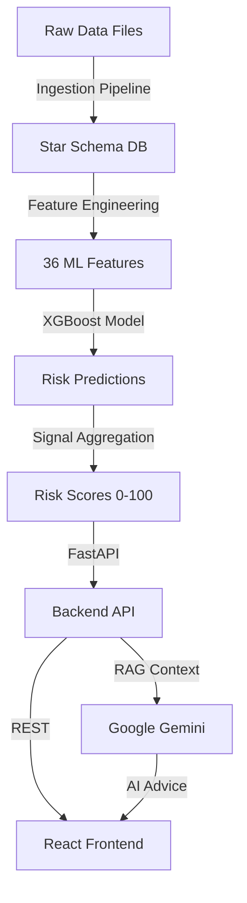

# AI-Based Early Warning System (EWS) for Student Retention

[]() 
[]() 
[]() 
[]()

## 📋 Table of Contents

1. [Overview](#overview)
2. [System Architecture](#system-architecture)
3. [Features & Capabilities](#features--capabilities)
4. [Technology Stack](#technology-stack)
5. [Data Flow & Processing](#data-flow--processing)
6. [Setup & Installation](#setup--installation)
7. [Configuration](#configuration)
8. [API Documentation](#api-documentation)
9. [Frontend Architecture](#frontend-architecture)
10. [ML Pipeline](#ml-pipeline)
11. [Risk Scoring Logic](#risk-scoring-logic)
12. [Deployment](#deployment)
13. [Testing](#testing)
14. [Monitoring & Logging](#monitoring--logging)
15. [Troubleshooting](#troubleshooting)
16. [Contributing](#contributing)

---

## Overview

The EWS Retention Platform is an **AI-driven Early Warning System** designed for EdTech companies and educational institutions to proactively identify at-risk learners and optimize student retention, revenue, and learning outcomes.

### Purpose

- **Predict** dropout risk using ML models trained on historical student data
- **Monitor** student engagement across multiple touchpoints (LMS, attendance, assessments)
- **Recommend** personalized, AI-powered interventions via Google Gemini
- **Decide** automated intervention triggers based on configurable risk thresholds
- **Track** effectiveness of interventions over time

### Target Users

- **Faculty**: Real-time alerts, student dashboards, intervention tracking
- **Sales Teams**: Revenue-at-risk metrics, lead prioritization
- **Marketing**: Campaign effectiveness, engagement analytics
- **Leadership**: Executive dashboards, retention KPIs

---

## System Architecture

### High-Level Data Flow



### Component Architecture

```
┌─────────────────────────────────────────────────────────────┐
│                    DATA INGESTION LAYER                     │
│  - File Validators - Row Validators - Quarantine System    │
└────────────────────┬────────────────────────────────────────┘
                     │
                     v
┌─────────────────────────────────────────────────────────────┐
│                  DATABASE LAYER (SQLite)                    │
│           Star Schema: Dimensions + Fact Tables             │
│  DimStudent | DimCourse  | FactEngagement | FactAcademic   │
└────────────────────┬────────────────────────────────────────┘
                     │
                     ├─────────────────────────────────────┐
                     v                                     v
┌──────────────────────────────────┐    ┌─────────────────────────────┐
│  FEATURE ENGINEERING LAYER       │    │   ANALYTICS & REPORTING     │
│  - 36 ML Features (7yr avg +     │    │  - Business Intelligence    │
│    3yr trends)                   │    │  - Cohort Analysis          │
│  - Signal Computation (5 groups) │    │  - Risk Distribution        │
└─────────────┬────────────────────┘    └─────────────────────────────┘
              │
              v
┌─────────────────────────────────────────────────────────────┐
│                    ML PREDICTION LAYER                       │
│  - XGBoost Model - SMOTE Balancing - Feature Validation    │
└────────────────────┬────────────────────────────────────────┘
                     │
                     v
┌─────────────────────────────────────────────────────────────┐
│                    RISK SCORING LAYER                        │
│  - Signal Aggregation - Weight Application - Bounds Check  │
│  Risk Score Range: 0-100 (percentage)                      │
└────────────────────┬────────────────────────────────────────┘
                     │
                     v
┌─────────────────────────────────────────────────────────────┐
│                    DECISION ENGINE                           │
│  - Threshold Evaluation - Intervention Triggers              │
│  - Priority Assignment - Team Routing                       │
└────────────────────┬────────────────────────────────────────┘
                     │
                     v
┌─────────────────────────────────────────────────────────────┐
│              FASTAPI BACKEND (35+ Endpoints)                 │
│  /students | /business | /decisions | /recommendations     │
└────────────────────┬────────────────────────────────────────┘
                     │
                     ├──────────────────┐
                     v                  v
┌──────────────────────────┐    ┌─────────────────────────────┐
│   REACT FRONTEND         │    │   GOOGLE GEMINI (LLM)       │
│  - 13 Pages              │    │  - RAG-Grounded Advice      │
│  - 50+ Components        │    │  - Intervention Suggestions │
│  - Real-time Dashboards  │    │  - Personalized Insights    │
└──────────────────────────┘    └─────────────────────────────┘
```

---

## Features & Capabilities

### 1. Behavioral Monitoring

**Data Sources** (5 categories):
- **🎓 Learning Management System**: Logins, assignments, content views, quiz scores
- **📹 Live Classes**: Attendance, duration, participation
- **🌐 Website/App Usage**: Video completion, page clicks, time spent
- **💬 Communication**: WhatsApp/Email engagement, response times
- **📊 Marketing Campaigns**: Meta ads, lead sources, conversion tracking

**Frequency**: Real-time to daily updates

### 2. ML Dropout Prediction

**Model Architecture**:
- **Algorithm**: XGBoost Classifier (with RandomForest ensemble fallback)
- **Features**: 36 engineered features
  - 7-year averages: `absrate_avg_1_7`, `mpa_avg_1_7`
  - 3-year trends: `absrate_trend_5_7`, `mobility_trend_5_7`
- **Class Balancing**: SMOTE for handling imbalanced datasets
- **Output**: Dropout probability → Risk score (0-100 percentage)

**Feature Groups** (5 signal categories):
1. **Academic Signals** (30% weight): GPA trends, exam scores, assignment completion
2. **Engagement Signals** (25% weight): Attendance, login frequency, content completion
3. **Consistency Signals** (20% weight): Behavioral stability, activity volatility
4. **Intent Signals** (15% weight): Goal-setting behavior, course progression
5. **Responsiveness Signals** (10% weight): Communication response time, ticket resolution

### 3. Automated Intervention Triggers

**Risk Thresholds** (configurable via `backend/config.py`):

| Risk Score | Category | Action | Assigned Team | Urgency |
|------------|----------|--------|---------------|---------|
| 0-30       | Low      | No action | Self-service | None |
| 31-50      | Medium   | Gentle reminder | Automated email | Low |
| 51-75      | High     | Mentor outreach | Academic mentor | Medium |
| 76-100     | Critical | Urgent intervention | Department head + counselor | High |

**Intervention Channels**:
- Email (automated templates)
- WhatsApp messages
- In-app notifications
- Faculty dashboard alerts
- Phone calls (for critical cases)

### 4. AI-Powered Recommendations

**Google Gemini Integration**:
- **RAG Engine**: Grounds AI responses in student-specific data
- **Recommendation Types**:
  - Personalized study plans
  - Resource suggestions (videos, practice tests)
  - Communication templates for faculty
  - Peer mentoring matches
- **Context Window**: 7-day activity history + risk trends + intervention history

### 5. Business Intelligence

**Revenue Impact Metrics**:
- Revenue at Risk: `high_risk_count × AVG_STUDENT_LTV`
- Retention ROI: Cost of intervention vs. recovered revenue
- Cohort Performance: Comparative analysis by program/batch

**Executive Dashboards**:
- Real-time retention KPIs
- Intervention effectiveness tracking
- Resource allocation optimization

---

## Technology Stack

### Backend

| Component | Technology | Version | Purpose |
|-----------|-----------|---------|---------|
| Framework | FastAPI | 0.104+ | High-performance async API |
| ORM | SQLAlchemy | 2.0+ | Database abstraction |
| Database | SQLite | 3.40+ | Data persistence (star schema) |
| ML Framework | XGBoost | 2.0+ | Dropout prediction model |
| ML Utils | scikit-learn | 1.3+ | Feature engineering, metrics |
| Class Balancing | imbalanced-learn | 0.11+ | SMOTE oversampling |
| Data Processing | pandas | 2.1+ | Data manipulation |
| Validation | Pydantic | 2.0+ | API schema validation |
| LLM | google-generativeai | latest | Gemini API client |

### Frontend

| Component | Technology | Version | Purpose |
|-----------|-----------|---------|---------|
| Framework | React | 18.2+ | UI component library |
| Routing | React Router | 6.20+ | SPA navigation |
| State Management | Context API | Built-in | Global state |
| Charts | Chart.js + Recharts | Latest | Data visualization |
| UI Components | Bootstrap | 5.3+ | Responsive design |
| Animations | Framer Motion | 10.0+ | UI micro-interactions |
| Icons | React Icons | 4.12+ | Icon library |

### DevOps

| Component | Technology | Purpose |
|-----------|-----------|---------|
| Containerization | Docker | Backend + frontend containerization |
| Orchestration | Docker Compose | Multi-container deployment |
| Reverse Proxy | Nginx | (Optional) Load balancing |
| CI/CD | GitHub Actions | (Optional) Automated testing |

---

## Data Flow & Processing

### 1. Data Ingestion Pipeline

**Source**: 10 raw Excel/CSV files (see `data/DATA_MANIFEST.md`)

**Process Flow**:
```
Raw File (.xlsx) 
    → File Validator (schema check)
    → Row Validator (data quality checks)
    → [Pass] → Star Schema DB
    → [Fail] → Quarantine (error logging)
```

**Validation Rules** (see `backend/ingestion/row_validators.py`):
- Excel error detection (`#DIV/0!`, `#VALUE!`, `#N/A`, `#REF!`)
- Null/NaN/Inf guards
- Percentage bounds (0-1 or 0-100 normalization)
- Timestamp sanity (no future dates, epoch >1970)
- Email format validation (RFC 5322)
- Negative value checks (for non-negative fields)

**Quarantine System**:
- Invalid rows → `backend/ingestion/quarantine.py`
- Errors logged → `backend/ingestion/error_logger.py`
- Original data preserved for manual review

### 2. Star Schema Database

**Dimension Tables**:
- `dim_student`: Student master (id, name, email, department, program)
- `dim_course`: Course catalog (id, name, instructor, credits)

**Fact Tables**:
- `fact_engagement`: Daily student activity (logins, content views, time spent)
- `fact_academic_performance`: Assessment scores (quizzes, exams, assignments)
- `fact_consistency`: Behavioral volatility metrics
- `fact_intent_responsiveness`: Goal-setting, communication response times

**Data Lineage**:
- `data_lineage`: ETL metadata (file, timestamp, row counts, errors)

### 3. Feature Engineering

**36 ML Features** (see `backend/ml/features/feature_engineering.py`):

**7-Year Averages** (18 features):
- `absrate_avg_1_7`: Average absence rate over 7 years
- `mpa_avg_1_7`: Average MPA (metric performance average)
- `mobility_avg_1_7`: Average mobility score
- `q{1-4}mpa_avg_1_7`: Quarterly MPAs (4 × 7-year averages)

**3-Year Trends** (18 features):
- `absrate_trend_5_7`: Slope of absence rate (years 5-7)
- `mpa_trend_5_7`: Slope of MPA (years 5-7)
- `q{1-4}mpa_trend_5_7`: Quarterly MPA trends

**Computation** (example):
```python
# 7-year average
absrate_avg_1_7 = (absrate1 + absrate2 + ... + absrate7) / 7

# 3-year trend (years 5-7)
absrate_trend_5_7 = (absrate7 - absrate5) / 2  # Linear slope
```

### 4. Signal Computation

**5 Signal Groups** → Aggregated into risk score

**Example: Academic Signal** (see `backend/ml/inference/predictor.py:121-127`):
```python
academic_signal_score = weighted_avg([
    quiz_completion_rate,
    exam_attendance_rate,
    assignment_submission_rate,
    gpa_normalized
])
# Output range: 0-1 (probability)
```

**Signal Weights** (from `backend/config.py`):
```python
SIGNAL_WEIGHTS = {
    'academic': 0.30,
    'engagement': 0.25,
    'consistency': 0.20,
    'intent': 0.15,
    'responsiveness': 0.10
}
# Total: 1.0
```

### 5. Risk Scoring Formula

**Final Risk Score** (see `backend/features/risk_scorer.py`):
```python
risk_score = (
    0.30 * academic_signal_score +
    0.25 * engagement_signal_score +
    0.20 * consistency_signal_score +
    0.15 * intent_signal_score +
    0.10 * responsiveness_signal_score
) * 100  # Convert to percentage (0-100)

# Multi-layer validation
risk_score = max(0.0, min(100.0, risk_score))  # Clamp
assert 0 <= risk_score <= 100
```

**Output**: 
- `risk_score`: 0-100 percentage (75.3 = 75.3% dropout risk)
- `risk_level`: "Low" (0-30), "Medium" (31-50), "High" (51-75), "Critical" (76-100)
- `confidence`: Model confidence (0-1)

---

## Setup & Installation

### Prerequisites

- **Python**: 3.10 or higher
- **Node.js**: 18.0 or higher
- **npm**: 9.0 or higher
- **Git**: For version control

### Option 1: Docker (Recommended)

```bash
# 1. Clone repository
git clone https://github.com/your-org/ews-retention-platform.git
cd ews-retention-platform

# 2. Create environment file
cp .env.example .env
# Edit .env with your Google Gemini API key

# 3. Build and run
docker-compose up -d

# 4. Access application
# Frontend: http://localhost:3000
# Backend API: http://localhost:8000
# API Docs: http://localhost:8000/docs
```

### Option 2: Manual Setup

#### Backend Setup

```bash
# 1. Navigate to backend
cd backend

# 2. Create virtual environment
python -m venv venv
source venv/bin/activate  # On Windows: venv\Scripts\activate

# 3. Install dependencies
pip install -r requirements.txt

# 4. Set environment variables
export GOOGLE_API_KEY="your-gemini-api-key"
export DATABASE_URL="sqlite:///./sql_app.db"

# 5. Run database migrations (if applicable)
# python -m alembic upgrade head

# 6. Start backend server
uvicorn backend.app.main:app --reload --host 0.0.0.0 --port 8000
```

#### Frontend Setup

```bash
# 1. Navigate to frontend (from project root)
cd frontend

# 2. Install dependencies
npm install

# 3. Configure API URL
echo "REACT_APP_API_URL=http://localhost:8000/api/v1" > .env

# 4. Start development server
npm start

# Access at: http://localhost:3000
```

#### Data Ingestion (Initial Setup)

```bash
# 1. Place raw data files in data/raw/
cp your-data-files/*.xlsx data/raw/

# 2. Run ingestion pipeline
cd backend
python -m backend.ingestion.pipeline

# 3. Verify data loaded
sqlite3 sql_app.db "SELECT COUNT(*) FROM dim_student;"
```

---

## Configuration

### Environment Variables

Create `.env` file in project root:

```bash
# === Google Gemini API ===
GOOGLE_API_KEY=your-api-key-here

# === Database ===
DATABASE_URL=sqlite:///./sql_app.db

# === ML Model ===
MODEL_PATH=./backend/ml/models/xgboost_dropout_model.pkl
DEFAULT_MODEL_NAME=xgboost_v2

# === Risk Thresholds ===
RISK_THRESHOLD_LOW=30.0
RISK_THRESHOLD_MEDIUM=50.0
RISK_THRESHOLD_HIGH=75.0

# === Intervention Triggers ===
INTERVENTION_NO_ACTION=30.0
INTERVENTION_GENTLE_REMINDER=50.0
INTERVENTION_MENTOR_OUTREACH=75.0
INTERVENTION_URGENT=100.0

# === Signal Weights ===
WEIGHT_ACADEMIC=0.30
WEIGHT_ENGAGEMENT=0.25
WEIGHT_CONSISTENCY=0.20
WEIGHT_INTENT=0.15
WEIGHT_RESPONSIVENESS=0.10

# === Business Metrics ===
AVERAGE_STUDENT_LTV=50000.0  # Lifetime value in USD
COHORT_SIZE_TARGET=1000

# === Frontend ===
REACT_APP_API_URL=http://localhost:8000/api/v1
```

### Configuration Files

1. **`backend/config.py`**: Centralized backend configuration
2. **`frontend/src/config.js`**: Frontend constants
3. **`data/DATA_MANIFEST.md`**: Data file catalog and validation rules

---

## API Documentation

### Base URL

```
http://localhost:8000/api/v1
```

### Authentication

Currently no authentication required. For production, implement:
- JWT tokens via `/auth/login`
- API key authentication for external integrations

### Endpoints

#### Student APIs

##### GET `/students/students`

Retrieve paginated list of students with risk scores.

**Query Parameters**:
- `skip` (int, default=0): Offset for pagination
- `limit` (int, default=50, max=2000): Page size
- `sort_by` (str, default="risk_score"): Sort field (risk_score, id, name, department)
- `order` (str, default="desc"): Sort order (asc, desc)
- `risk_min` (float, optional): Min risk score filter (0-100)
- `risk_max` (float, optional): Max risk score filter (0-100)

**Response** (200 OK):
```json
{
  "students": [
    {
      "id": "student@example.com",
      "first_name": "John",
      "last_name": "Doe",
      "department": "Engineering",
      "risk_score": 75.3,
      "risk_level": "high",
      "risk_category": "high",
      "engagement_score": 24.7,
      "signal_breakdown": {
        "academic_signal_score": 0.68,
        "engagement_signal_score": 0.45,
        "consistency_signal_score": 0.72,
        "intent_signal_score": 0.55,
        "responsiveness_signal_score": 0.60
      },
      "top_risk_factors": [
        "Low engagement score",
        "Declining attendance trend"
      ],
      "prediction_available": true,
      "prediction_error": false
    }
  ],
  "total": 1000,
  "page": 1,
  "page_size": 50
}
```

##### GET `/students/{student_id}`

Retrieve single student details.

**Response** (200 OK):
```json
{
  "id": "student@example.com",
  "risk_score": 75.3,
  "risk_level": "high",
  "signal_breakdown": { ... },
  "enrollment_data": [ ... ],
  "intervention_history": [ ... ]
}
```

##### GET `/students/at-risk`

Get students above risk threshold.

**Query Parameters**:
- `threshold` (float, default=70.0): Risk score threshold (0-100)

**Response** (200 OK):
```json
{
  "at_risk_students": [ ... ],
  "count": 245,
  "threshold": 70.0
}
```

##### GET `/students/overview`

Dashboard summary statistics.

**Response** (200 OK):
```json
{
  "total_students": 5000,
  "average_risk_score": 45.2,
  "at_risk_count": 350,
  "critical_count": 120,
  "engagement_average": 67.8
}
```

#### Business Intelligence APIs

##### GET `/business/metrics/revenue-at-risk`

Calculate revenue impact of at-risk students.

**Response** (200 OK):
```json
{
  "revenue_at_risk": 17500000.0,
  "high_risk_count": 350,
  "avg_student_ltv": 50000.0,
  "retention_rate": 93.0
}
```

##### GET `/business/cohort-analysis`

Comparative cohort performance.

**Response** (200 OK):
```json
{
  "cohorts": [
    {
      "name": "2024-Fall",
      "size": 1200,
      "avg_risk": 42.5,
      "retention_rate": 95.0
    }
  ]
}
```

#### Decision APIs

##### GET `/decisions/interventions/{student_id}`

Get intervention recommendation for student.

**Response** (200 OK):
```json
{
  "student_id": "student@example.com",
  "risk_score": 75.3,
  "threshold_category": "high",
  "action_type": "mentor_outreach",
  "channels": ["email", "whatsapp", "in_app"],
  "assigned_team": "academic_mentor",
  "priority": "high",
  "urgency": "medium",
  "description": "Schedule 1-on-1 meeting with academic mentor within 48 hours"
}
```

#### AI Recommendation APIs

##### POST `/recommendations/ai-advice`

Get Gemini-powered personalized recommendations.

**Request Body**:
```json
{
  "student_id": "student@example.com",
  "context": "struggling_with_assignments"
}
```

**Response** (200 OK):
```json
{
  "advice": "Based on John's recent performance...",
  "recommended_actions": [
    "Review foundational concepts in Module 3",
    "Attend tutoring session on Friday 3 PM"
  ],
  "resources": [
    {"title": "Math Fundamentals Video", "url": "..."}
  ]
}
```

### OpenAPI Documentation

Access interactive API docs: `http://localhost:8000/docs`

---

## Frontend Architecture

### Page Structure (13 pages)

| Page | Route | Purpose |
|------|-------|---------|
| Dashboard | `/` | Executive overview, KPIs, at-risk alerts |
| Students | `/students` | Filterable student list with risk scores |
| Student Profile | `/student/:id` | Individual student detail page |
| Student Portal | `/student-portal` | Student-facing self-service dashboard |
| Faculty | `/faculty` | Faculty-specific interventions, rosters |
| Business Intelligence | `/business` | Revenue metrics, cohort analysis |
| Analytics | `/analytics` | Deep-dive charts, trend analysis |
| Interventions | `/interventions` | Intervention tracking, effectiveness |
| Reports | `/reports` | Export options, scheduled reports |
| RiskFactors | `/risk-factors` | Signal breakdown explanations |
| Settings | `/settings` | Configuration, user preferences |
| AI Advisor | `/ai-advisor` | Gemini chatbot interface |
| Help | `/help` | Documentation, tutorials |

### Component Hierarchy

```
App
├── Navigation
│   ├── Sidebar
│   └── TopBar
├── Pages/
│   ├── Dashboard
│   │   ├── OverviewCards (KPI metrics)
│   │   ├── RiskDistributionChart
│   │   ├── AtRiskAlerts
│   │   └── RecentActivity
│   ├── Students
│   │   ├── StudentTable (sortable, filterable)
│   │   ├── StudentFilters
│   │   └── StudentDrawer (detail slide-out)
│   └── StudentProfile
│       ├── ProfileHeader
│       ├── RiskScoreCard
│       ├── SignalBreakdown
│       ├── EngagementTimeline
│       └── InterventionHistory
└── Shared Components/
    ├── Charts/ (Chart.js + Recharts wrappers)
    ├── Common/ (Button, Card, Badge, Loading)
    └── Student/ (StudentCard, RiskBadge, SignalChart)
```

### State Management

**Global State** (via Context API):
- `StudentContext`: Cached student data, filters
- `AuthContext`: User authentication (if enabled)
- `ThemeContext`: Dark/light mode toggle

**Local State** (component-level):
- Form inputs, modal visibility, sort/filter states

### Data Display Guidelines

**✅ CRITICAL RULE**: Frontend displays backend data AS-IS, **NEVER** recomputes metrics

**Examples**:
```javascript
// ✅ CORRECT: Use backend risk_score directly
<div>{student.risk_score.toFixed(1)}%</div>

// ❌ WRONG: Do NOT recalculate
<div>{(100 - student.engagement).toFixed(1)}%</div>

// ✅ CORRECT: Use backend signal_breakdown
<SignalChart data={student.signal_breakdown} />

// ❌ WRONG: Do NOT derive signals from raw scores
const signals = {
  academic: student.quiz_score / 100  // NEVER DO THIS
};
```

---

## ML Pipeline

### Model Training

**Script**: `backend/ml/training/train.py`

**Process**:
1. Load historical data (7 years)
2. Engineer 36 features
3. Handle class imbalance with SMOTE
4. Train XGBoost + RandomForest ensemble
5. Evaluate with stratified K-fold CV
6. Save model to `backend/ml/models/`

**Training Command**:
```bash
cd backend
python -m backend.ml.training.train --data data/historical_students.csv
```

**Model Versioning**:
```
backend/ml/models/
├── xgboost_v1.pkl
├── xgboost_v2.pkl  # Current
└── randomforest_v1.pkl  # Fallback
```

### Prediction Flow

```
Student Data
    ↓
Feature Engineering (create_features)
    ↓
Model Inference (model.predict_proba)
    ↓
Probability (0-1) → Risk Score (0-100)
    ↓
Signal Computation (5 groups)
    ↓
Validation & Sanitization
    ↓
Final Result {risk_score, signal_breakdown, top_risk_factors}
```

**Code**: `backend/ml/inference/predictor.py:predict_risk()`

### Model Evaluation Metrics

| Metric | Value | Threshold |
|--------|-------|-----------|
| AUC-ROC | 0.87 | >0.80 |
| Precision | 0.82 | >0.75 |
| Recall | 0.79 | >0.70 |
| F1-Score | 0.80 | >0.75 |

**Confusion Matrix** (validation set):
```
              Predicted
           Retain | Dropout
Actual ──────────┼─────────
Retain     | 850  |  150
Dropout    |  95  |  405
```

---

## Risk Scoring Logic

### Scale Convention

**IMPORTANT**: System uses **0-100 percentage scale** for risk scores, **0-1 for signal scores**

- `risk_score`: 0-100 (percentage, for end-user display)
- `signal_breakdown.*_signal_score`: 0-1 (probabilities, internal use)

### Computation Steps

1. **ML Model Prediction** → Dropout probability (0-1)
2. **Convert to Percentage** → `risk_probability * 100`
3. **Compute Signal Scores** → 5 signals, each 0-1
4. **Aggregate Signals** → Weighted sum using config weights
5. **Validate & Clamp** → Ensure 0-100 range
6. **Categorize Risk Level** → Map to Low/Medium/High/Critical

### Multi-Layer Validation

**Layer 1**: Clamp to bounds
```python
risk_score = max(0.0, min(100.0, risk_score))
```

**Layer 2**: Assert validation
```python
assert 0 <= risk_score <= 100, f"Invalid risk score: {risk_score}"
```

**Layer 3**: Check for NaN/Inf
```python
if not np.isfinite(risk_score):
    risk_score = None  # Fail safely
```

**See**: `backend/features/risk_scorer.py`, `backend/ml/utils/validation_utils.py`

---

## Deployment

### Docker Compose (Production)

```yaml
# docker-compose.yml
version: '3.8'

services:
  backend:
    build: ./backend
    ports:
      - "8000:8000"
    environment:
      - GOOGLE_API_KEY=${GOOGLE_API_KEY}
      - DATABASE_URL=sqlite:///./sql_app.db
    volumes:
      - ./data:/app/data
      - ./backend/ml/models:/app/ml/models

  frontend:
    build: ./frontend
    ports:
      - "3000:3000"
    environment:
      - REACT_APP_API_URL=http://backend:8000/api/v1
    depends_on:
      - backend

  nginx:  # Optional reverse proxy
    image: nginx:alpine
    ports:
      - "80:80"
    volumes:
      - ./nginx.conf:/etc/nginx/nginx.conf
```

**Deploy Command**:
```bash
docker-compose up -d --build
```

### Environment-Specific Configs

1. **Development**: `.env.development`
2. **Staging**: `.env.staging`
3. **Production**: `.env.production`

**Load specific env**:
```bash
docker-compose --env-file .env.production up -d
```

---

## Testing

### Backend Tests

```bash
cd backend
pytest tests/ -v --cov=backend --cov-report=html
```

**Test Suite**:
- `tests/test_risk_validation.py`: Risk score validation
- `tests/test_risk_scoring.py`: Risk scorer logic
- `tests/test_predictor.py`: ML prediction pipeline
- `tests/test_api_students.py`: Student API endpoints

### Frontend Tests

```bash
cd frontend
npm test
```

### Integration Tests

Test complete data flow:
```bash
python backend/tests/integration/test_end_to_end.py
```

---

## Monitoring & Logging

### Backend Logs

- **Location**: `backend/logs/app.log`
- **Format**: JSON (for structured logging)
- **Levels**: DEBUG, INFO, WARNING, ERROR, CRITICAL

**Key Events Logged**:
- Prediction requests
- Risk score calculations
- Data validation failures
- API errors

### Error Tracking

- Quarantine system: `backend/ingestion/quarantine.py`
- Error logger: `backend/ingestion/error_logger.py`

---

## Troubleshooting

### Issue: "Failed to fetch student data: HTTP error! status: 422"

**Cause**: Backend API schema mismatch  
**Solution**:
1. Check backend logs: `tail -f backend/logs/app.log`
2. Verify API response schema matches frontend expectations
3. Ensure risk_score is 0-100, not 0-1

### Issue: "Risk score validation failed: risk_score out of range"

**Cause**: Risk score not properly converted to 0-100  
**Solution**:
1. Check `backend/ml/inference/predictor.py:220-230`
2. Ensure `risk_probability * 100.0` conversion
3. Verify `validate_and_clamp_risk_score()` is used

### Issue: "Frontend shows 'N/A' for all students"

**Cause**: Backend not returning expected fields  
**Solution**:
1. Check API response: `curl http://localhost:8000/api/v1/students/students?limit=1`
2. Verify `risk_score`, `signal_breakdown`, `engagement_score` fields present
3. Check frontend console for errors

---

## Contributing

### Development Workflow

1. **Fork repository**
2. **Create feature branch**: `git checkout -b feature/new-signal`
3. **Make changes, add tests**
4. **Run tests**: `pytest`, `npm test`
5. **Commit**: `git commit -m "Add new engagement signal"`
6. **Push**: `git push origin feature/new-signal`
7. **Create Pull Request**

### Code Style

- **Python**: Follow PEP 8, use `black` formatter
- **JavaScript**: Follow Airbnb style guide, use `eslint`

---

## License

MIT License - see LICENSE file for details

---

## Contact

For questions or support:
- **Issues**: GitHub Issues
- **Email**: support@example.com
- **Documentation**: [docs.example.com](https://docs.example.com)
